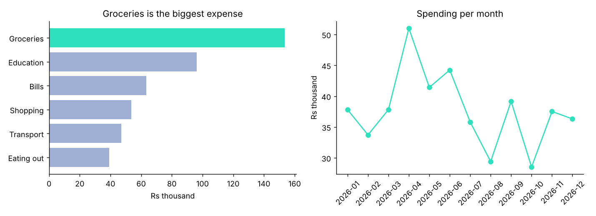

# Where does the money go?

*Stage 1 · Python & Tools* · [All projects](../../README.md#projects)

Load a year of expenses with Pandas, total them per category and month, and draw two clear charts.



## Run it
```bash
python make_data.py
python analyse.py
```

## What you practise
Pandas `groupby`, date handling, Matplotlib with a title that states the finding.
