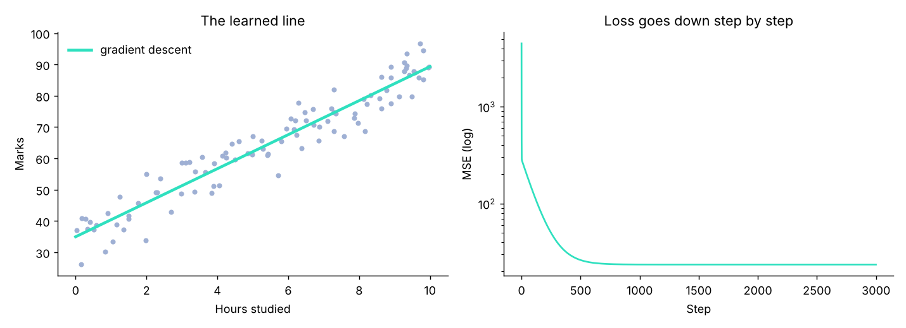

# Gradient descent from scratch

*Stage 2 · Math for ML* · [All projects](../../README.md#projects)

Fit a line to hours-studied vs marks by walking downhill on the error, then check against the exact solution (they match: 34.96 + 5.43 × hours).



## Run it
```bash
python gradient_descent.py
```

## What you practise
Derivatives, learning rate, why the loss falls.
