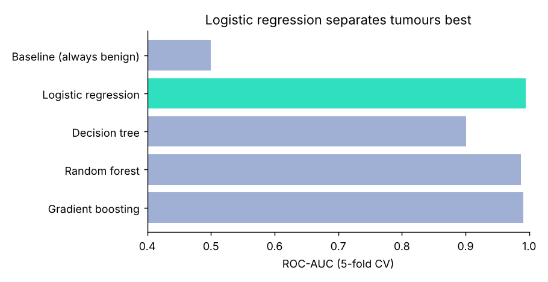

# Honest model comparison: breast cancer diagnosis

*Stage 4 · Classic ML* · [All projects](../../README.md#projects)

Five models compared with 5-fold cross-validation. Logistic regression wins (ROC-AUC 0.995) and catches 92.9% of malignant tumours on the held-out test set. The 'always benign' baseline scores 63% accuracy but catches 0% of cancers, which shows why accuracy alone misleads.



## Run it
```bash
python compare_models.py
```

## What you practise
Baselines, cross-validation, recall vs accuracy, choosing a model before touching the test set.
