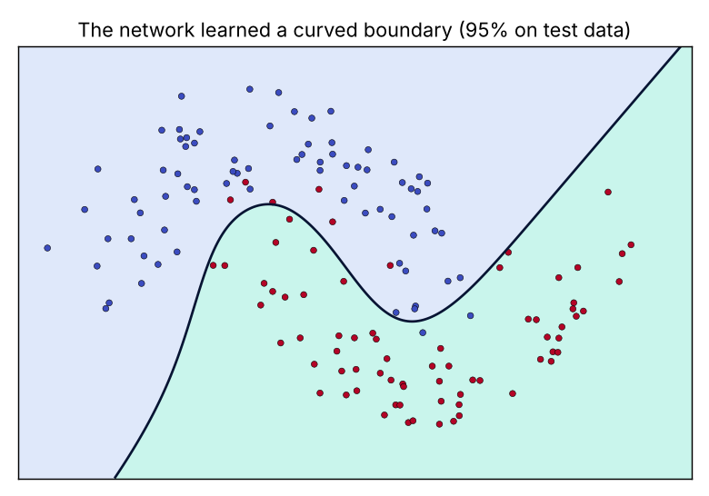

# A neural network from scratch

*Stage 5 · Deep Learning* · [All projects](../../README.md#projects)

A 2-layer network in plain NumPy (forward pass, backpropagation, gradient descent) learns a curved boundary: 94.7% test accuracy, where a straight-line model gets about 86%.



## Run it
```bash
python neural_net.py
```

## What you practise
Activations, cross-entropy, backpropagation by hand.
