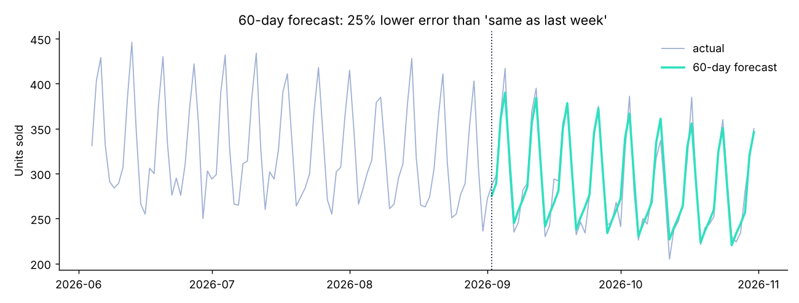

# Two mini-projects: forecasting and RAG

*Stage 6 · Specialisation* · [All projects](../../README.md#projects)

**forecast.py:** forecasts 60 days of daily shop sales from calendar features (weekday, season, Eid, trend), with 25% lower error than 'same as last week'.

**rag_lite.py:** the retrieval half of RAG. It searches all the notes in this repository and builds the prompt you would send to an LLM.



## Run it
```bash
python forecast.py
python rag_lite.py "what is data leakage?"
```

## What you practise
Time-based testing, naive baselines, seasonality; chunking, TF-IDF retrieval, grounded prompts.
